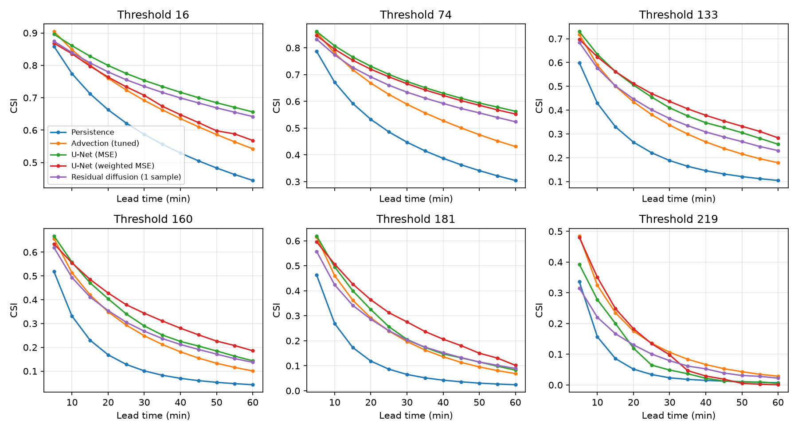
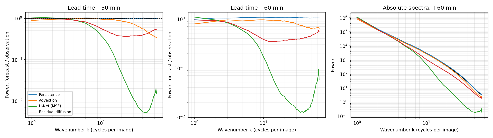
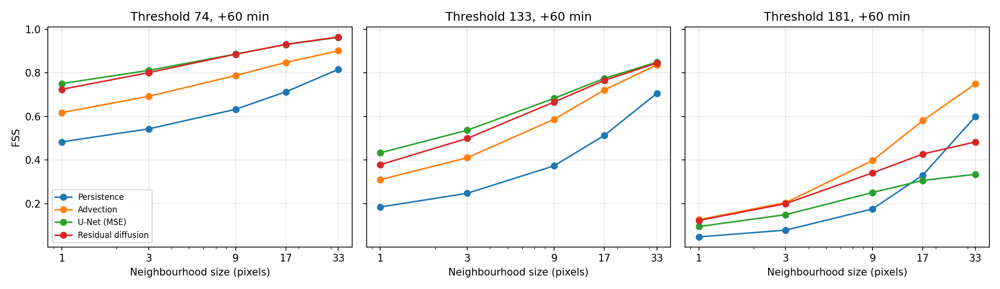
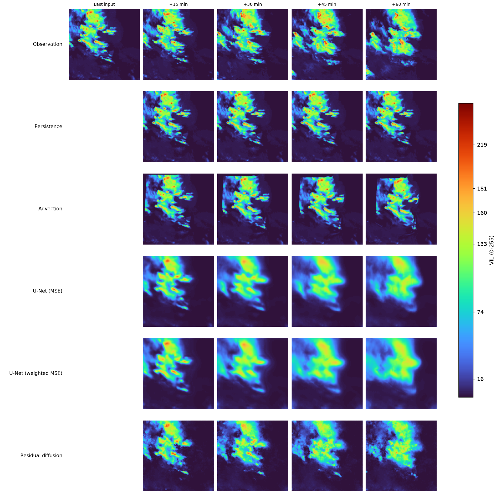

# Precipitation nowcasting on SEVIR: U-Net baselines, sharpness diagnostics and residual diffusion

Predict the next hour of radar-derived precipitation intensity (VIL) from the previous hour:
13 input frames, 5 minutes apart, in; 12 forecast frames out (+5 to +60 min), at 128x128 pixels.

This project is less about reaching a leaderboard number than about **measuring what a
deep-learning nowcast actually gets wrong, and checking whether a generative model fixes it**.

**What I found**

- A temporal U-Net clearly beats tuned optical-flow advection (CSI-M 0.42 vs 0.37 on the test
  split) but produces blurry forecasts: it keeps only 2-5 % of the small-scale power of the
  observations and covers 39 % (threshold 181) and 12 % (threshold 219) of the area of intense echoes (validation split).
- A residual diffusion model on top of a frozen U-Net restores part of that detail and intensity,
  at a measurable cost: a single sample has 0.025 lower CSI-M than the U-Net it refines.
- As an 8-member ensemble it reduces CRPS by 27 % relative to the deterministic U-Net, and by
  10 % relative to a control that simply adds Gaussian noise to the U-Net forecast. Most of the
  CRPS gain over the U-Net comes from dispersion alone; the diffusion-specific gain is the smaller part.
- The ensemble is under-dispersive (spread/skill 0.54) and its mean is as blurry as the U-Net.

## Task and data

- **Data**: [SEVIR](https://registry.opendata.aws/sevir/) VIL images (storm-event files only, 2017-2019),
  uint8 values 0-255, 49 frames per event, 5 minutes apart.
- **Resolution**: 384x384 frames are average-pooled to 128x128 and cached as uint8 (about 2.8 GB in total).
  Scores are therefore **not directly comparable to published SEVIR benchmarks**.
- **Splits (by time, no leakage between windows of one event)**: train until 2019-03-01
  (2,541 events), validation 2019-03-01 to 2019-06-01 (368 events), test from 2019-06-01 (627 events).
  Each event gives 3 windows of 25 frames (13 in, 12 out).

## Methods compared

| Model | Description |
|---|---|
| Persistence | Repeat the last observed frame. |
| Advection | Farneback optical flow, constant-motion extrapolation. `lookback` and `winsize` tuned on validation (4 and 31). |
| U-Net (MSE) | Temporal U-Net, 1.9 M parameters, input frames stacked as channels. MSE loss. |
| U-Net (weighted MSE) | Same network, loss weight `1 + 5 * target` to emphasise intense pixels. |
| Residual diffusion | Frozen U-Net (MSE) gives the mean forecast `mu`; a conditional diffusion model (8.4 M parameters, v-prediction, cosine schedule, EMA weights, 20-step DDIM sampling) learns the residual `y - mu`, conditioned on `mu` and the last 4 observed frames. |

The residual diffusion model is a **simplified two-stage variant** of the idea in DiffCast
(Yu et al., CVPR 2024), which trains the deterministic and diffusion parts jointly.

Training: U-Nets for 30 epochs, three seeds per loss; diffusion for 40 epochs (one seed), all on a Kaggle GPU.

## Evaluation protocol

Fixed before looking at the test split, and tagged in git (`eval-freeze`).

- **CSI / POD / FAR** at the standard SEVIR VIL thresholds 16, 74, 133, 160, 181, 219 (0-255 scale).
  Hits, misses and false alarms are **accumulated over the whole split** and the score is computed once,
  not averaged per sample. **CSI-M** is the mean CSI over the six thresholds.
- **Frequency bias**: forecast area above a threshold divided by observed area (1 is ideal).
- **Radially averaged power spectrum**: ratio of forecast to observed power by spatial scale (1 = same detail).
- **Fractions Skill Score (FSS)** for neighbourhoods of 1 to 33 pixels, thresholds 74, 133, 181.
- **Ensemble scores**: fair CRPS, spread/skill ratio (1 = reliable) and Brier score, against the
  deterministic U-Net (CRPS = MAE) and a Gaussian-noise control ensemble whose standard deviation is
  fitted per lead time and intensity bin on training data.
- **Model selection** used the validation split only. The test split was evaluated once, with frozen models.

## Results

### Deterministic scores on the test split

| Model | CSI@16 | CSI@74 | CSI@133 | CSI@160 | CSI@181 | CSI@219 | CSI-M | MSE |
|---|---|---|---|---|---|---|---|---|
| Persistence | 0.589 | 0.456 | 0.219 | 0.139 | 0.104 | 0.057 | 0.261 | 0.0173 |
| Advection (tuned) | 0.688 | 0.589 | 0.346 | 0.264 | 0.218 | 0.136 | 0.373 | 0.0099 |
| U-Net (MSE) | **0.750** | **0.675** | 0.427 | 0.328 | 0.261 | 0.105 | 0.424 | **0.0056** |
| U-Net (weighted MSE) | 0.686 | 0.662 | **0.441** | **0.360** | **0.301** | **0.150** | **0.433** | 0.0066 |
| Residual diffusion (1 sample) | 0.733 | 0.637 | 0.381 | 0.295 | 0.237 | 0.109 | 0.399 | 0.0068 |

CSI-M on validation was 0.246, 0.376, 0.418, 0.429 and 0.394 for the same five models: the ranking is
unchanged and no model moves by more than 0.015, which suggests the validation-based tuning and
checkpoint selection did not inflate the test results. Across three seeds the last-epoch validation
CSI-M was 0.409 (range 0.408-0.410) for the MSE U-Net and 0.423 (0.420-0.427) for the weighted one;
differences below about 0.01 CSI-M between single runs should not be over-read.



### What the diagnostics show (validation split)

| Model | Power ratio, small scales (k 16-64), +30 / +60 min | Frequency bias @181 / @219 | FSS@181, 9 px / 33 px, +60 min |
|---|---|---|---|
| Persistence | 1.00 / 1.07 | 1.01 / 1.03 | 0.176 / 0.599 |
| Advection (tuned) | 0.82 / 0.87 | 0.84 / 0.79 | 0.397 / 0.749 |
| U-Net (MSE) | 0.052 / 0.026 | 0.39 / 0.12 | 0.251 / 0.334 |
| U-Net (weighted MSE) | 0.038 / 0.017 | 0.62 / 0.23 | 0.338 / 0.460 |
| Residual diffusion (1 sample) | 0.381 / 0.372 | 0.48 / 0.30 | 0.363 / 0.507 |

The U-Net wins on pixel-wise scores while being blurry and under-forecasting intense echoes; the FSS at
181 does not recover with a larger tolerance (0.334 at 33 px), which points to missing intense area rather
than only mislocated cells. The diffusion model improves all three columns but remains far from the ideal
on intensity.




### Qualitative examples

Random sample from the validation split (rows: observation, persistence, advection, U-Net MSE,
weighted U-Net, residual diffusion). Animated versions are in `assets/final/`.



### Residual diffusion as an ensemble (test split, 8 members)

| Forecast | CSI-M | bias@181 | bias@219 | MSE |
|---|---|---|---|---|
| U-Net backbone | 0.424 | 0.44 | 0.17 | 0.00557 |
| Diffusion, 1 member | 0.399 | 0.53 | 0.36 | 0.00680 |
| Diffusion, mean of 8 | 0.415 | 0.41 | 0.15 | 0.00563 |

| Forecast | CRPS +30 min | CRPS +60 min | CRPS all leads | Spread/skill | Brier 74 | Brier 133 | Brier 181 |
|---|---|---|---|---|---|---|---|
| U-Net (deterministic, MAE) | 0.0323 | 0.0463 | 0.0323 | - | 0.0469 | 0.0265 | 0.0081 |
| Gaussian noise on U-Net (8 members) | 0.0264 | 0.0367 | 0.0261 | 0.83 | 0.0391 | 0.0225 | 0.0073 |
| Residual diffusion (8 members) | **0.0235** | **0.0335** | **0.0235** | 0.54 | **0.0376** | **0.0216** | **0.0071** |

- The ensemble mean recovers the MSE of the U-Net but not its CSI-M, and its frequency bias returns to the U-Net's.
- CRPS: -27 % versus the deterministic U-Net, -10 % versus the Gaussian control (validation: -28 % and -9 %).
- Brier: 12-20 % better than the 0/1 U-Net forecast, but only 3-4 % better than the Gaussian control, and the
  difference at threshold 181 (0.0071 vs 0.0073) is within rounding. A 0/1 forecast is a weak reference for
  Brier, so the diffusion-specific evidence is the CRPS gap to the control.

## Limitations

- **Resolution and dataset**: 128x128 pooled images, one dataset, US storm events only. No claim about other regions or sensors.
- **Single seeds** for the diffusion model and for the test evaluations; three seeds only for the U-Net validation study.
- **Checkpoints**: the two U-Nets use the best validation epoch, a noisy criterion (in mid-training the validation CSI-M moved by up to about 0.06
  between consecutive epochs). Test scores agree with validation, but a last-epoch protocol would be cleaner. The diffusion model uses its last epoch.
- **Sharpness diagnostics (spectrum, FSS) were computed on the validation split only.**
- **Diffusion model**: simplified two-stage variant; all members share the same backbone forecast, so large-scale
  position errors are not represented in the spread (spread/skill 0.54); 20-step deterministic sampling; limited training budget.
- **CRPS is computed pixel by pixel** and does not measure the spatial coherence of members, which is what the diffusion model is meant to add.
- The Gaussian control is a simple baseline (independent noise); a spatially correlated control might narrow the gap.

## Reproduce

```bash
uv sync
uv run python scripts/download_sevir.py --years 2017 2018 2019 --pattern "*STORMEVENTS*" --dry-run   # check the size first (about 26 GB)
uv run python scripts/download_sevir.py --years 2017 2018 2019 --pattern "*STORMEVENTS*"
uv run python scripts/build_cache.py --root data/sevir --cache-dir data/cache
uv run pytest

# baselines
uv run python scripts/evaluate_baselines.py --model persistence --cache-dir data/cache --split val
uv run python scripts/tune_advection.py --cache-dir data/cache

# U-Net (GPU recommended)
python scripts/train.py --cache-dir data/cache --epochs 30 --seed 42
python scripts/train.py --cache-dir data/cache --epochs 30 --seed 42 --loss weighted_mse

# residual diffusion on a frozen U-Net
python scripts/train_diffusion.py --backbone-ckpt checkpoints/unet_mse_best.ckpt --cache-dir data/cache --epochs 40

# evaluation
python scripts/evaluate_baselines.py --model unet --checkpoint checkpoints/unet_mse_best.ckpt --cache-dir data/cache --split val
python scripts/evaluate_sharpness.py --cache-dir data/cache --split val --diffusion "Residual diffusion=checkpoints/diffusion_final.ckpt"
python scripts/evaluate_ensemble.py --checkpoint checkpoints/diffusion_final.ckpt --cache-dir data/cache --members 8 --gaussian-baseline
uv run python scripts/plot_results.py
uv run python scripts/make_gifs.py --cache-dir data/cache --split val --select random --n 3 --diffusion "Residual diffusion=checkpoints/diffusion_final.ckpt"
```

Pre-trained weights are not stored in the repository: <LINK TO RELEASE OR MODEL HUB>.

## Repository layout

```
src/nowcasting/
  data/          SEVIR dataset and uint8 cache
  models/        baselines, U-Net, diffusion network, model loading
  metrics.py     CSI / POD / FAR / bias (accumulated counts)
  sharpness.py   radial power spectrum and FSS
  ensemble.py    fair CRPS, spread/skill, Brier
  lit.py, lit_diffusion.py   training modules (PyTorch Lightning)
scripts/         download, cache, train, evaluate, plot
tests/           unit tests (metrics, dataset, cache, models, diffusion, sharpness, ensemble)
results/         evaluation JSON files, training logs, result tables
assets/          figures and animations used in this README
```

## References

- M. Veillette, S. Samsi, C. Mattioli. *SEVIR: A Storm Event Imagery Dataset for Deep Learning Applications in Radar and Satellite Meteorology.* NeurIPS 2020.
- D. Yu et al. *DiffCast: A Unified Framework via Residual Diffusion for Precipitation Nowcasting.* CVPR 2024.
- A. Nichol, P. Dhariwal. *Improved Denoising Diffusion Probabilistic Models.* ICML 2021 (cosine schedule).
- T. Salimans, J. Ho. *Progressive Distillation for Fast Sampling of Diffusion Models.* ICLR 2022 (v-prediction).
- J. Song, C. Meng, S. Ermon. *Denoising Diffusion Implicit Models.* ICLR 2021 (DDIM).
- N. Roberts, H. Lean. *Scale-selective verification of rainfall accumulations from high-resolution forecasts of convective events.* Mon. Weather Rev. 2008 (FSS).
- C. Ferro. *Fair scores for ensemble forecasts.* Q. J. R. Meteorol. Soc. 2014 (fair CRPS).

## License

<CHOOSE A LICENSE>. The SEVIR data have their own terms: see the dataset page.
